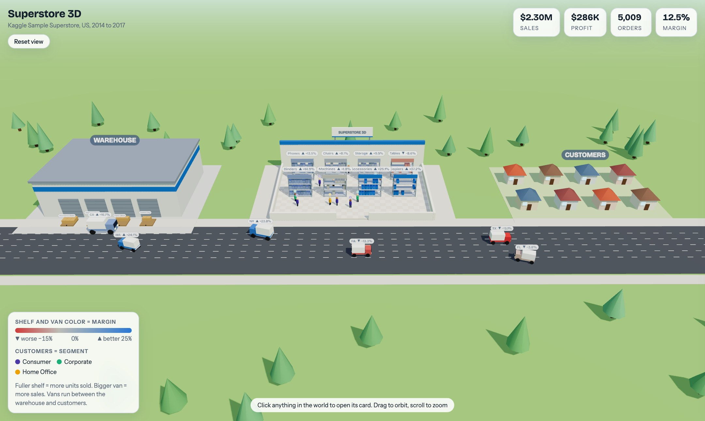

# 3D Dashboard Skill

Turn any dataset into an interactive 3D world. Give your AI assistant a CSV or Excel file, and it builds a single HTML page where your business is a place: a warehouse, a store, a neighborhood, and vans driving between them. Every object is a real data point. Click it to fly in and see its numbers.



The scene above is the Kaggle Sample Superstore dataset (US retail, 2014 to 2017). Shelves are product sub-categories, vans are the top six states, the dock bays at the warehouse are shipping modes, and the people are customer segments. Blue means profit, red means loss.

## What it does

- Reads your data (CSV, Excel, JSON, Parquet) and works out what the business is.
- Picks a **domain kit** so the world looks like your industry: a store, a hospital, a data center, a factory, a city, a restaurant, a campus or a wind farm.
- Lays the world out like a real operation: a source site, the main site and a destination along one road, with vehicles driving back and forth between them.
- Maps your columns to objects: things you hold become shelves, racks or beds, places and channels become vehicles, process steps become dock bays or desks, customer groups become people.
- Colors everything by one health metric (profit margin, readmission rate, churn, defect rate) on a red to blue scale that works for colorblind viewers. Labels also carry an arrow and the value, so color is never the only signal.
- Finds a real finding in your data and puts it on the landmark sign.
- Writes one self-contained `.html` file you can open in any browser. No server, no build step.

Click any object and the camera flies to it and opens a card:


## Domain kits

Every kit is a line of three places along one road. The same spec works in every kit, so you can switch the look with one flag. The images below all use the Superstore data so the kits are easy to compare. With real hospital or factory data the labels would match the domain.


| Kit | Use for | Places along the road | Main site holds | Vehicles | People |
| --- | --- | --- | --- | --- | --- |
| `retail` | stores, ecommerce, FMCG | warehouse, store, customers' homes | shelves | vans | shoppers |
| `datacenter` | SaaS, product analytics, IT ops | offices, data center, edge sites | server racks | drones | engineers |
| `healthcare` | hospitals, clinics, pharma | homes, hospital, clinics | ward bays with beds | ambulances | patients |
| `factory` | manufacturing, supply chain, logistics | suppliers, plant, port | machines with moving arms | trucks | workers |
| `city` | finance, real estate, anything unclear | suburbs, towers, harbor | office towers | cars | clients |
| `hospitality` | restaurants, hotels, food delivery | farms, restaurant, customers | dining tables | scooters | guests |
| `education` | schools, universities, edtech | homes, school, sports field | classrooms | buses | students |
| `energy` | utilities, climate, agriculture | solar field, wind farm, town | wind turbines | service trucks | technicians |

## Install

The skill is the `data-world-3d` folder in this repo. First get it:

```bash
git clone https://github.com/techwithprateek/3d-dashboard-skill.git
cd 3d-dashboard-skill
```

### Claude Code

Personal install, available in every project:

```bash
mkdir -p ~/.claude/skills
cp -R data-world-3d ~/.claude/skills/
```

Or install for one project only:

```bash
mkdir -p .claude/skills
cp -R data-world-3d .claude/skills/
```

Start a new Claude Code session, then ask:

```
Use the data-world-3d skill on sales.csv
```

You can also type `/data-world-3d`.

### Claude Desktop and claude.ai

1. Zip the skill folder:
   ```bash
   zip -r data-world-3d.zip data-world-3d
   ```
2. Open **Settings → Capabilities → Skills** and upload `data-world-3d.zip`. Menu names change from time to time, so look for the Skills section.
3. Make sure code execution and file creation are on, because the skill runs Python to aggregate your data.
4. Attach your data file and ask: "Turn this into a 3D world with the data-world-3d skill." Download the HTML file Claude creates and open it in your browser.

### Other assistants (Codex, Cursor, Gemini CLI and others)

The skill is plain Markdown plus scripts, and it follows the standard `SKILL.md` layout. Two ways to use it:

- If your tool supports skills, copy the `data-world-3d` folder into that tool's skills directory.
- If not, put the folder in your project and tell the assistant: "Read `data-world-3d/SKILL.md` and follow it for `my-data.csv`."

### No assistant at all

The scripts work on their own. Write a spec (see below) and run:

```bash
python3 data-world-3d/scripts/profile_data.py my-data.csv
python3 data-world-3d/scripts/build_world.py --data my-data.csv --spec spec.json --out my-world.html
```

### Requirements

- Python 3.9+ with `pandas` (`pip install pandas`). Add `openpyxl` for Excel files.
- Node 18+ is optional. It is only used by `scripts/smoke_test.mjs`, a check that runs the page without a browser.
- A WebGL browser and an internet connection when you open the page, because it loads three.js and fonts from a CDN.

## Using it

Example prompts:

```
Use data-world-3d on orders.csv. Color by profit margin.
Turn patients.xlsx into a 3D hospital. Lower readmission rate is better.
Make a 3D world from this Kaggle dataset: olistbr/brazilian-ecommerce
Same data, but as a city instead of a store.
```

What the assistant does:

1. Profiles the file and picks a domain kit.
2. Chooses the health metric and which column feeds shelves, vehicles, desks and people.
3. Looks for a real finding and writes the spec.
4. Builds the page and checks that it runs.
5. Tells you what each object stands for and anything it left out.

## The spec

Everything is driven by one small JSON file. A shortened version of the Superstore spec:

```json
{
  "title": "Superstore 3D",
  "domain": "retail",
  "metrics": [
    {"key": "sales",  "label": "Sales",  "agg": "sum", "col": "Sales",  "fmt": "money"},
    {"key": "profit", "label": "Profit", "agg": "sum", "col": "Profit", "fmt": "money"},
    {"key": "margin", "label": "Margin", "expr": "profit/sales*100", "fmt": "pct"}
  ],
  "health": {"metric": "margin", "good": "high", "range": [-15, 0, 25]},
  "slots": {
    "fixtures":  {"dimension": "Sub-Category", "size": "sales", "top": 8},
    "movers":    {"dimension": "State", "size": "sales", "top": 6},
    "terminals": {"dimension": "Ship Mode", "size": "sales"},
    "actors":    {"dimension": "Segment", "size": "sales"}
  }
}
```

The full format is in [`data-world-3d/references/spec-schema.md`](data-world-3d/references/spec-schema.md). A complete example is in [`data-world-3d/examples/`](data-world-3d/examples/), along with the finished page, `superstore-3d.html`. Download it and open it in a browser to try the world yourself.

## Good to know

- Your raw rows never go into the page. Only the aggregated numbers per group are embedded.
- Each slot shows the top N groups (8 shelves, 6 vehicles, 4 desks, 4 people groups). The rest are left out, and the assistant should tell you how many.
- The number of people is proportional to each group's share, not exact.
- Every value on a card comes from your data. Insights are written from the numbers, and the assistant adds a finding only when the data supports it.
- Every kit uses the same linear plan: a source site, the main site and a destination along one road. Kits change the places and props, not the plan, so the main site is always a hall-sized area with up to 8 fixtures.
- The scene was checked in headless Chromium and with a Node smoke test that opens every card. Phones get a bottom-sheet card. It has not been tested on every device.

## Add your own domain

Open `data-world-3d/assets/kits.js` and add an entry next to the others. A kit provides `sky`, `ground`, `road`, `from`, `to`, `words`, `hero()`, `source()`, `dest()`, `terminalAt`, `fixture(item)`, `mover(item)`, `terminal(item)` and `landmark(text)`. `source()` and `dest()` build the places at either end of the road, and the engine ships helpers for houses, warehouses, silos, cranes, masts and more. Builders get an item with `size01` (0 to 1), `color` (the health color) and `metrics`, and return a three.js group. Copy the closest existing kit and change the props.

## Credits

The idea of turning a business into a clickable 3D world comes from a reel by @nocode.joshua. The sample data is the [Sample Superstore dataset on Kaggle](https://www.kaggle.com/datasets/vivek468/superstore-dataset-final). The 3D engine is [three.js](https://threejs.org).

## License

MIT. See [LICENSE](LICENSE).
