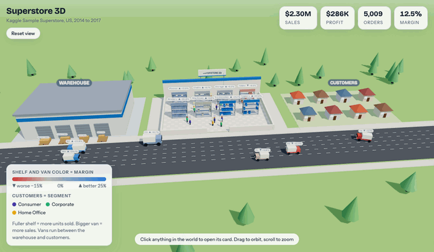
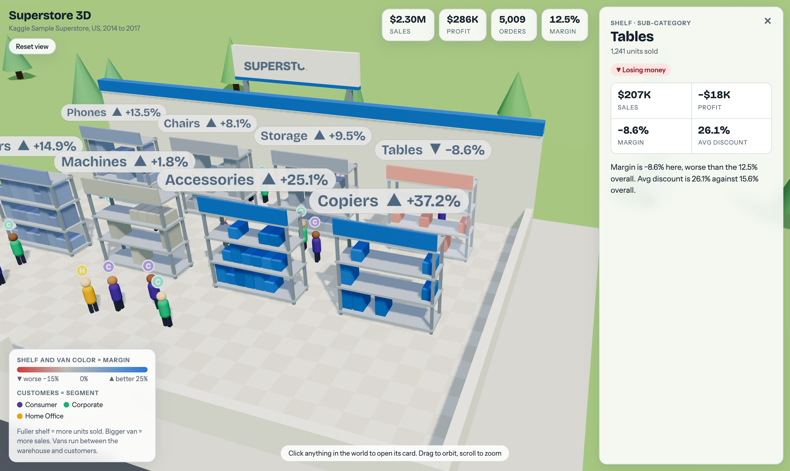
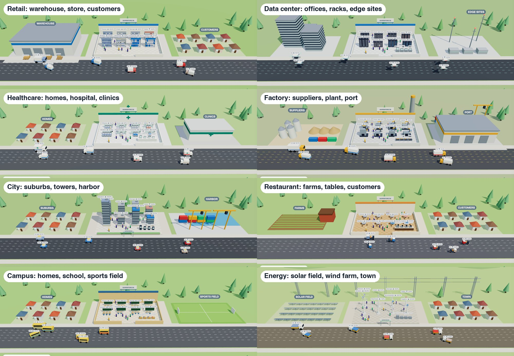

<h1 align="center">3D Dashboard Skill</h1>

<p align="center">
  <b>Turn any dataset into an interactive 3D world your team can explore.</b><br>
  Warehouses, stores, hospitals, data centers, factories, cities. Every object is a real data point you can click.
</p>

<p align="center">
  
  
  
  
</p>

<p align="center">
  
  
  
</p>

<p align="center">
  <a href="#quick-start">Quick start</a> ·
  <a href="#domain-kits">Domain kits</a> ·
  <a href="#usage">Usage</a> ·
  <a href="#install-options">Install options</a> ·
  <a href="#learn-more">Learn more</a> ·
  <a href="#contributing">Contributing</a> ·
  <a href="#troubleshooting">Troubleshooting</a>
</p>

<p align="center">
  
</p>

<p align="center">
  <sub>Built from the public <a href="https://www.kaggle.com/datasets/vivek468/superstore-dataset-final">Sample Superstore dataset on Kaggle</a> (5,009 orders). Recorded in headless Chromium from <a href="examples/superstore-3d.html"><code>examples/superstore-3d.html</code></a>.</sub>
</p>

---

## Quick start

**1. Install** (Claude Code):

```bash
git clone https://github.com/techwithprateek/3d-dashboard-skill.git ~/.claude/skills/data-world-3d
```

**2. Ask**, in a new Claude Code session:

```
Use data-world-3d on my-data.csv
```

**3. Open** the `my-data-3d.html` file it creates in any browser. Click anything.

You need Python 3.9+ with pandas (`pip install pandas`, plus `openpyxl` for Excel files) and a browser with an internet connection. Not using Claude Code? See [Install options](#install-options).

## What it does

You give your AI assistant a CSV or Excel file. It reads the data, picks a world that fits your industry, finds something real in the numbers, and hands back one `.html` file. No server, no build step, no charting code.

- **Your business becomes a place.** Things you hold become shelves, racks or beds. Places and channels become vehicles driving down a road. Process steps become dock bays or desks. Customer groups become people.
- **One health metric colors everything.** Profit margin, readmission rate, churn, defect rate. Red to blue, so you see problems before you read a number.
- **Click anything.** The camera flies in and opens a card with the numbers and a plain-language insight.
- **Honest and accessible.** Every value comes from your data. Colors work for colorblind viewers, and labels also carry an arrow and the value.

<p align="center">
  
</p>

## Domain kits

Every kit is a line of three places along one road, with vehicles driving between them. The same spec works in every kit, so you can switch the look with one flag. The images use the same Superstore data in each kit so they are easy to compare. With real hospital or factory data the labels would match the domain.

<p align="center">
  
</p>

| Kit | Use for | Places along the road | Main site holds | Vehicles | People |
| --- | --- | --- | --- | --- | --- |
| `retail` | stores, ecommerce, FMCG | warehouse, store, customers' homes | shelves | vans | shoppers |
| `datacenter` | SaaS, product analytics, IT ops | offices, data center, edge sites | server racks | drones | engineers |
| `healthcare` | hospitals, clinics, pharma | homes, hospital, clinics | ward bays with beds | ambulances | patients |
| `factory` | manufacturing, supply chain, logistics | suppliers, plant, port | machines with moving arms | trucks | workers |
| `city` | finance, real estate, anything unclear | suburbs, towers, harbor | office towers | cars | clients |
| `hospitality` | restaurants, hotels, food delivery | farms, restaurant, customers | dining tables | scooters | guests |
| `education` | schools, universities, edtech | homes, school, sports field | classrooms | buses | students |
| `energy` | utilities, climate, agriculture | solar field, wind farm, town | wind turbines | service trucks | technicians |

## Usage

Just describe what you want:

```
Turn orders.csv into a 3D world. Color it by profit margin.

Make a 3D hospital from patients.xlsx. Lower readmission rate is better.

Make a 3D world from this Kaggle dataset: olistbr/brazilian-ecommerce

Same data, but show it as a city instead of a store.
```

In Claude Code you can also type `/data-world-3d`.

What happens next:

1. The assistant profiles the file and tells you which kit it picked and why.
2. It states the health metric and which column feeds shelves, vehicles, desks and people.
3. It builds the page and checks that it runs.
4. It tells you what each object stands for, the finding on the sign, and anything it left out.

## Install options

<details>
<summary><b>Claude Code: project-only install and updating</b></summary>

&nbsp;

Install for one project only, run from your project root:

```bash
git clone https://github.com/techwithprateek/3d-dashboard-skill.git .claude/skills/data-world-3d
```

Update an install later:

```bash
git -C ~/.claude/skills/data-world-3d pull
```

The folder must be named `data-world-3d`.

</details>

<details>
<summary><b>Claude Desktop and claude.ai</b></summary>

&nbsp;

1. Clone the repo, then zip **only the skill files**, not the whole checkout:
   ```bash
   git clone https://github.com/techwithprateek/3d-dashboard-skill.git data-world-3d
   cd data-world-3d
   zip -r ../data-world-3d.zip SKILL.md assets scripts references examples
   ```
2. Open **Settings → Capabilities → Skills** and upload `data-world-3d.zip`. Menu names change from time to time, so look for the Skills section.
3. Turn on code execution and file creation. The skill runs Python to aggregate your data.
4. Attach your data file and ask: "Turn this into a 3D world with the data-world-3d skill." Download the HTML file Claude creates and open it in your browser.

</details>

<details>
<summary><b>Other AI assistants (Cursor, Windsurf, Codex CLI, Continue and more)</b></summary>

&nbsp;

The skill is plain Markdown plus scripts in the standard `SKILL.md` layout. If your tool supports skills, clone the repo into its skills directory as `data-world-3d`:

| Tool | Skills directory |
| --- | --- |
| Cursor | `.cursor/skills/` or `~/.cursor/skills/` |
| Windsurf | `.windsurf/skills/` |
| Codex CLI, Antigravity and other agents using the shared standard | `.agents/skills/` or `~/.agents/skills/` |
| Continue | `.continue/skills/` |
| Droid (Factory) | `.factory/skills/` |

For example:

```bash
git clone https://github.com/techwithprateek/3d-dashboard-skill.git ~/.agents/skills/data-world-3d
```

These paths follow the conventions other skill packs use. If your tool differs, check its documentation. If it has no skill support at all, clone the repo into your project and tell the assistant: "Read `data-world-3d/SKILL.md` and follow it for `my-data.csv`."

</details>

<details>
<summary><b>No assistant at all</b></summary>

&nbsp;

The scripts run on their own. See the command line steps under [Learn more](#learn-more).

</details>

## Learn more

<details>
<summary><b>How it works</b></summary>

&nbsp;

```
┌─────────────────────────────────────────────────────────────────┐
│  1. YOU ASK                                                     │
│     "Use data-world-3d on orders.csv. Color by profit margin."  │
└─────────────────────────────────────────────────────────────────┘
                              │
                              ▼
┌─────────────────────────────────────────────────────────────────┐
│  2. PROFILE            scripts/profile_data.py                  │
│     columns, measures, categories, likely domain                │
└─────────────────────────────────────────────────────────────────┘
                              │
                              ▼
┌─────────────────────────────────────────────────────────────────┐
│  3. PLAN               the assistant                            │
│     pick a kit · pick the health metric (what is good or bad)   │
│     map columns to shelves, vehicles, desks and people          │
│     find one real finding in the data                           │
└─────────────────────────────────────────────────────────────────┘
                              │   spec.json
                              ▼
┌─────────────────────────────────────────────────────────────────┐
│  4. BUILD              scripts/build_world.py                   │
│     aggregate with pandas · embed the numbers · write one HTML  │
└─────────────────────────────────────────────────────────────────┘
                              │
                              ▼
┌─────────────────────────────────────────────────────────────────┐
│  5. VERIFY             scripts/smoke_test.mjs                   │
│     build the scene, run frames, open every card, no browser    │
└─────────────────────────────────────────────────────────────────┘
                              │
                              ▼
                     my-world.html  (open it)
```

For the Superstore data above, the assistant produces a plan like this before it builds anything:

```
+--------------------------------------------------------------------------------+
|  DATA: Kaggle Sample Superstore - 9,994 rows, 5,009 orders, 2014 to 2017       |
+--------------------------------------------------------------------------------+
|                                                                                |
|  KIT: retail            warehouse  ->  store  ->  customers' homes             |
|                                                                                |
|  HEALTH METRIC: profit margin (high is good)                                   |
|     scale:   red -15%  |  grey 0%  |  blue +25%                                |
|                                                                                |
|  SLOTS:                                                                        |
|     SHELVES     Sub-Category   8 groups   size: units sold                     |
|     VANS        State          6 groups   size: sales, speed: orders           |
|     DOCK BAYS   Ship Mode      4 groups   size: sales                         |
|     PEOPLE      Segment        3 groups   17 figures, split by sales           |
|                                                                                |
|  STORY (on the sign):                                                          |
|     Orders discounted over 20% are 14% of lines and lost $135K in total.       |
|                                                                                |
|  CHECKS:                                                                       |
|     [x] smoke test passed, 36 clickable objects                                |
|     [x] every card value comes from the data                                   |
|     [x] top-N groups only, the rest are left out and reported                  |
|                                                                                |
+--------------------------------------------------------------------------------+
```

</details>

<details>
<summary><b>The spec and the command line</b></summary>

&nbsp;

One small JSON file drives everything. A shortened version of the Superstore spec:

```json
{
  "title": "Superstore 3D",
  "domain": "retail",
  "metrics": [
    {"key": "sales",  "label": "Sales",  "agg": "sum", "col": "Sales",  "fmt": "money"},
    {"key": "profit", "label": "Profit", "agg": "sum", "col": "Profit", "fmt": "money"},
    {"key": "margin", "label": "Margin", "expr": "profit/sales*100", "fmt": "pct"}
  ],
  "health": {"metric": "margin", "good": "high", "range": [-15, 0, 25]},
  "slots": {
    "fixtures":  {"dimension": "Sub-Category", "size": "sales", "top": 8},
    "movers":    {"dimension": "State", "size": "sales", "top": 6},
    "terminals": {"dimension": "Ship Mode", "size": "sales"},
    "actors":    {"dimension": "Segment", "size": "sales"}
  }
}
```

| Slot | What it becomes | Up to |
| --- | --- | --- |
| `fixtures` | shelves, racks, beds, machines, towers | 8 |
| `movers` | vans, drones, ambulances, trucks, cars | 6 |
| `terminals` | dock bays, consoles, desks, kiosks | 4 |
| `actors` | people, one color per group | 4 groups |

The full format is in [`references/spec-schema.md`](references/spec-schema.md). A complete example sits in [`examples/`](examples/).

Run the scripts yourself:

```bash
# 1. See what is in the file
python3 scripts/profile_data.py my-data.csv

# 2. Build the world from a spec
python3 scripts/build_world.py --data my-data.csv --spec spec.json --out my-world.html

# 3. Try the same data in another kit
python3 scripts/build_world.py --data my-data.csv --spec spec.json --out my-world-city.html --domain city

# 4. Check that the page runs (no browser needed, needs Node 18+)
node scripts/smoke_test.mjs my-world.html
```

</details>

<details>
<summary><b>Design principles</b></summary>

&nbsp;

- **The data decides.** Cards, labels and sizes are computed from your file. The assistant adds a finding only when the numbers support it.
- **Color is never the only signal.** Labels carry an arrow and the value, and cards carry a text status.
- **Say what was left out.** Each slot shows the top groups only. The assistant tells you how many were dropped.
- **People are proportional.** The number of figures follows each group's share. It is not an exact count.
- **Your rows stay local.** The page embeds only the aggregated numbers per group, never the raw rows.

</details>

<details>
<summary><b>Project structure</b></summary>

&nbsp;

```
3d-dashboard-skill/               # clone this as data-world-3d
├── SKILL.md                      # the instructions the assistant follows
├── assets/
│   ├── engine.js                 # camera, cards, legend, picking, motion
│   ├── kits.js                   # the 8 domain kits
│   └── template.html             # page shell and styles
├── scripts/
│   ├── profile_data.py           # profile a data file
│   ├── build_world.py            # aggregate data and write the HTML
│   └── smoke_test.mjs            # run the scene without a browser
├── references/
│   ├── spec-schema.md            # spec format
│   └── domains.md                # which kit to pick, mapping examples
├── examples/
│   ├── superstore.spec.json
│   └── superstore-3d.html
├── docs/                         # README images
├── README.md
└── LICENSE
```

</details>

## Contributing

Pull requests are welcome. The most useful contribution is a new domain kit.

<details>
<summary><b>Add a domain kit and test it</b></summary>

&nbsp;

Open `assets/kits.js` and add an entry next to the others. Copy the closest existing kit and change the props. A kit provides:

| Member | Purpose |
| --- | --- |
| `sky`, `ground`, `road` | colors for the scene |
| `from`, `to`, `route` | what the vehicles travel between |
| `words` | names used in cards and the legend |
| `hero()` | the main site, with up to 8 fixture spots |
| `source()`, `dest()` | the places at either end of the road |
| `fixture(item)`, `mover(item)`, `terminal(item)` | builders that return a three.js group |
| `terminalAt`, `landmark(text)` | where the terminals stand and the sign |

Builders receive an item with `size01` (0 to 1), `color` (the health color) and `metrics`. The engine ships helpers for houses, warehouses, silos, cranes, masts, pylons, fields and more.

Test your change with the Superstore data from Kaggle:

```bash
for d in retail datacenter healthcare factory city hospitality education energy; do
  python3 scripts/build_world.py --data "Sample - Superstore.csv" --spec examples/superstore.spec.json \
    --out /tmp/$d.html --domain $d && node scripts/smoke_test.mjs /tmp/$d.html
done
```

Every line should print `OK`. Then open the page and look at it, because the smoke test cannot see overlaps or odd colors. Please include a screenshot in your pull request.

</details>

## Troubleshooting

<details>
<summary><b>Common problems and fixes</b></summary>

&nbsp;

**The page is blank or stuck on "Building the world..."**
The page loads three.js and fonts from a CDN. Check your internet connection and that WebGL is enabled in your browser. A restricted corporate network can also block the CDN.

**`ModuleNotFoundError: No module named 'pandas'`**
Install it yourself: `pip install pandas`. For `.xlsx` files also run `pip install openpyxl`.

**`Metric 'x': column 'y' not found`**
The error lists the real column names. Fix the `col` in your spec so it matches exactly, including capitals and spaces.

**The smoke test downloads something**
The first run installs `three@0.160.0` into a temporary folder so it can run the scene code. It needs `npm` and a network connection once.

**Labels overlap in the first view**
The default view shows the whole chain, so labels are small. Click an object or scroll to zoom in, and the labels scale up.

**Claude says the zip contains too many files**
You zipped the whole checkout, including `.git` and the README images. Zip only `SKILL.md assets scripts references examples`, about a dozen files.

**The world shows my top 8 only**
That is by design. Each slot shows the top groups, and the rest are left out. Raise `top` in the spec for vehicles or desks, or use `rank_by` to choose what counts as top.

</details>

## Credits

The idea of turning a business into a clickable 3D world comes from a reel by [@nocode.joshua](https://www.instagram.com/nocode.joshua/). The sample data is the [Sample Superstore dataset](https://www.kaggle.com/datasets/vivek468/superstore-dataset-final) on Kaggle. The 3D engine is [three.js](https://threejs.org). The red to blue scale and the segment colors come from a palette checked for color-vision differences.

## Star history

[](https://star-history.com/#techwithprateek/3d-dashboard-skill&Date)

## License

This project is licensed under the [MIT License](LICENSE).
